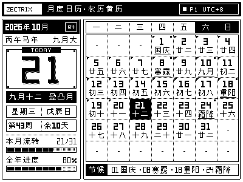
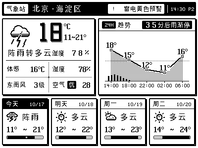

# ZECTRIX NOTE4 青龙面板多合一自动化调度套件 (Python 极轻量版)

[](https://www.python.org/)
[](https://github.com/whyour/qinglong)
[-orange.svg)](https://cloud.zectrix.com)
[](LICENSE)

针对 **ZECTRIX NOTE4** 电子墨水屏设备打造的青龙面板（Qinglong Panel）纯原生 Python 自动化调度套件。

将原本需要常驻后台的三套独立 Rust 守护服务（**Codex 额度/重置雷达**、**月度日历/传统黄历**、**画廊级多源气象站**）深度精简并重构为一个高度集成的 Python 单文件解决方案。每个任务执行完毕即刻释放内存与进程，彻底告别多端口常驻与高并发锁竞争。

---

## 效果预览 (400×300 1-bit 纯黑白画质)

| Page 1: 月度日历与传统黄历 | Page 2: 画廊级多源气象站 | Page 3: Codex 额度与重置雷达 |
| :---: | :---: | :---: |
|  |  |  |
| 传统农历、二十四节气、精细宜忌 | 多源天气共识融合、空气质量、预警 | 实时 Token 监控、额度重置雷达预测 |

---

## 核心特性

- **轻量级运行，无常驻占用**：青龙 Crontab 调度驱动，单次执行完毕即刻退出，内存零残留，不霸占后台进程与端口。
- **离线原生点阵渲染引擎**：仅依赖基础 `Pillow` 库，内置 201 年高精度农历历表、24 节气表与全量 400×300 墨水屏 1-bit 纯黑白栅格化字库，无额外大型 C 扩展或 Node/Rust 编译依赖。
- **企业级凭证安全脱敏**：
  - 严禁在日志中打印真实 Token、Cookie、Password 与设备 MAC 地址；
  - 采用原子写入（Atomic File Replace）与 `0600` 严格权限模式保存 OAuth 会话，避免并发损坏；
  - 额度支持普通 Codex OAuth 与带 `use_siwc=true` 的 Apple/Web 轮换刷新流。
- **智能防刷与哈希防抖（Image Hash Deduplication）**：
  - 严格计算每帧渲染画面的 SHA-256 哈希指纹；
  - 仅当画面内容发生实质性变动且满足最小推送间隔（默认 60s）时才调用云端上屏接口，大幅节约设备唤醒电量与网络请求。
- **多源天气融合与自动兜底 (Multi-Source Consensus)**：
  - 集成中央气象台 NMC、中国天气网、Open-Meteo 高精经纬度网格、彩云天气、和风天气等公共信源；
  - 支持全国内地 3000+ 区县地理编码与拼音/商圈检索，断网自动回退至有效数据缓存，不发伪天气。

---

## 项目结构与文件说明

仓库内主要由以下文件构成，**青龙部署时请保持在同一目录**：

```text
├── zectrix_ql.py              # 核心主程序（包含全功能命令行调度、渲染管线与网络同步逻辑）
├── zectrix_bitmaps.json.gz    # 核心点阵字模、气象插画、农历与节气数据库（必选）
├── weather_locations.json     # 全国内地省市区县气象站代码与经纬度映射表
├── .env.example               # 青龙面板环境变量配置模版（含详细注释）
├── test_zectrix_ql.py         # 单元测试与离线断言套件（11 项核心用例覆盖）
├── requirements.txt           # 基础运行依赖（仅包含 Pillow）
├── QA_REPORT.md               # 验收测试与渲染对齐技术报告
└── LICENSE-*.txt              # 开源许可证与 Noto CJK 字体声明
```

---

## 快速上手与青龙部署指南

### 第一步：安装依赖

在青龙面板的「**依赖管理**」→「**Python3**」添加依赖：
- `Pillow`

*(无需安装 requests、cryptography 或 bs4，核心网络请求使用标准库原生实现)*

### 第二步：导入脚本与资源文件

将仓库中的所有文件上传至青龙容器内的脚本目录（如 `/ql/data/scripts/zectrix/`），或通过青龙面板的「**脚本管理**」上传。确保 `zectrix_ql.py`、`zectrix_bitmaps.json.gz` 与 `weather_locations.json` 保持在同级目录下。

### 第三步：配置环境变量

在青龙「**环境变量**」中添加你的设备凭证（亦可在脚本同级目录下创建 `.env` 文件）：

| 变量名 | 必填 | 默认值 | 详细说明 |
| :--- | :---: | :---: | :--- |
| `ZECTRIX_DEVICE_ID` | **是** | - | 你的 NOTE4 设备 ID（如 `AA:BB:CC:DD:EE:FF`） |
| `ZECTRIX_API_KEY` | **是** | - | 设备云端 OpenAPI Key |
| `ZECTRIX_DATA_DIR` | 否 | `/ql/data/config/zectrix` | 状态缓存与渲染预览图持久化存储目录 |
| `CODEX_AUTH_PATH` | 否 | `/ql/data/config/codex.json` | CPA 或 Codex OAuth 会话 JSON 路径 |
| `WEATHER_LOCATION` | 否 | `兰州` | 天气所在城市或区县（支持中文/拼音/经纬度） |
| `WEATHER_PROVIDER` | 否 | `aggregate` | 天气信源模式（`aggregate` 多源融合 / `nmc` / `auto`） |
| `ZECTRIX_MIN_PUSH_SECONDS` | 否 | `60` | 两次上屏推送的最小物理间隔（秒） |

详细可选参数请查阅 `.env.example`。

### 第四步：添加青龙定时任务

在青龙面板「**定时任务**」中分别创建调度指令（根据你的脚本实际存放路径调整）：

| 任务名称 | 定时规则 (Cron) | 运行命令 | 对应墨水屏页面 |
| :--- | :--- | :--- | :---: |
| **NOTE4 - 月历与黄历** | `5 0 * * *` *(每天 00:05)* | `task zectrix/zectrix_ql.py --task calendar` | **第 1 页** |
| **NOTE4 - 多源气象站** | `*/30 * * * *` *(每 30 分钟)* | `task zectrix/zectrix_ql.py --task weather` | **第 2 页** |
| **NOTE4 - Codex 额度** | `*/30 7-23 * * *` *(白天每半小时)* | `task zectrix/zectrix_ql.py --task quota` | **第 3 页** |
| **NOTE4 - 额度雷达保底** | `0 * * * *` *(整点刷新)* | `task zectrix/zectrix_ql.py --task radar` | **第 3 页** |
| **NOTE4 - OAuth 令牌保活** | `0 */12 * * *` *(每 12 小时)* | `task zectrix/zectrix_ql.py --task auth-refresh` | *(无屏幕变动)* |

> **时区建议**：青龙面板系统时区建议设置为 `Asia/Shanghai`（中国标准时间 UTC+8）。

---

## 本地命令行排查与离线预览

若需要在未连接设备或开发环境下验证画面输出，可使用 `--preview` 参数生成离线 PNG：

```bash
# 离线预览 Codex 额度画面
python3 zectrix_ql.py --task quota --preview --output quota_preview.png

# 离线预览指定日期的月历与传统农历
python3 zectrix_ql.py --task calendar --preview --date 2026-10-28 --output calendar_preview.png

# 离线预览模拟降雨天气的气象卡片
python3 zectrix_ql.py --task weather --preview --demo rain --output weather_preview.png

# 检索内置区县与气象测站编码
python3 zectrix_ql.py --task weather --locations --location 海淀
```

---

## 常见问题与排查指南

1. **执行时报 `zectrix_bitmaps.json.gz not found`？**
   - 请确保 `zectrix_bitmaps.json.gz` 文件存放在与 `zectrix_ql.py` 相同的目录下，该文件包含经过高度压缩的全部墨水屏字模与天气插画。
2. **画面没有刷新上屏？**
   - 检查任务执行日志。如果画面内容没有任何变化，系统会触发哈希去重命中 `Unchanged` 并跳过推送；若需强制上传测试，可追加 `--force` 参数（例如 `python3 zectrix_ql.py --task weather --force`）。
3. **第 3 页被保护报错 `reserved page protected`？**
   - 系统默认开启了第 3 页专属于 Codex 额度与重置雷达的安全保护逻辑。若确实需要测试跨页，请确保使用对应的 `--task` 命令。

---

## 许可证说明

- 脚本主逻辑基于 [MIT License](LICENSE) 开源；
- 点阵数据资源整合自开源上游项目，并包含遵守 [SIL OFL 1.1](OFL-Noto.txt) 许可的 Noto Sans CJK SC 衍生点阵位图；
- 严禁在公开代码仓库中提交包含真实设备密钥、MAC 地址或用户私密 Token 的配置文件。
